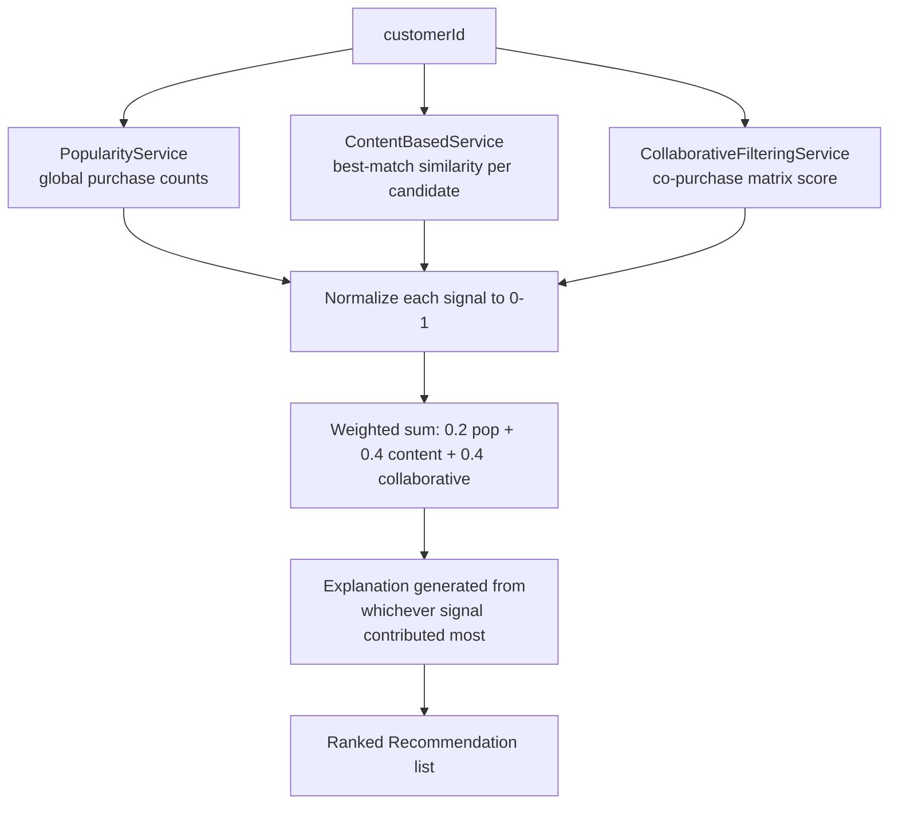

# Architecture

## Pipeline



### ASCII fallback

```
customerId
   |-- PopularityService        (global purchase counts)
   |-- ContentBasedService      (best-match similarity to a purchased product)
   '-- CollaborativeFilteringService (co-purchase matrix score)
        |
        v
   normalize each signal to [0,1] per customer's candidate set
        |
        v
   weighted sum: 0.2 x popularity + 0.4 x content + 0.4 x collaborative
        |
        v
   explanation generated from whichever signal contributed most
        |
        v
   ranked Recommendation list
```

## Components

| Component | Responsibility |
|---|---|
| `PopularityService` | Global purchase counts per product |
| `ContentBasedService` | Best-match similarity between a candidate and the customer's purchases, with the driving purchase tracked |
| `CollaborativeFilteringService` | Builds the co-purchase matrix once; scores candidates by co-occurrence with the customer's purchases |
| `HybridRecommendationService` | Normalizes, combines, and generates the explanation from the winning signal |
| `RecommendationController` | `GET /api/customers/{id}/recommendations` |

## Important Interfaces

- `ContentBasedService.ScoredCandidate` and `CollaborativeFilteringService.ScoredCandidate`
  both carry a `drivingProductId` — the specific prior purchase responsible
  for the score. `HybridRecommendationService` reads this directly when
  building the explanation sentence, so the explanation can never drift
  out of sync with the number that produced it.
- The co-purchase matrix is built **once**, in `CollaborativeFilteringService`'s
  constructor, from the entire purchase history — not recomputed per request.

## External Dependencies

- Spring Web (runtime)
- Spring Boot Test (JUnit 5, AssertJ — test scope only)
- No recommendation/ML platform — see docs/design-decisions.md

## Decision Points

- **Each signal is normalized against the customer's own candidate set**,
  not a global maximum — otherwise a customer with a small, tight purchase
  history (any single similarity score is already high) could
  systematically outrank a customer whose candidates only ever reach
  moderate absolute similarity, purely as a normalization artifact.
- **Content-based scoring takes the single best-matching purchase**, not an
  average across all purchases — the explanation ("because you bought X")
  needs one specific, defensible reason, and averaging would blur which
  purchase actually justified the recommendation.
